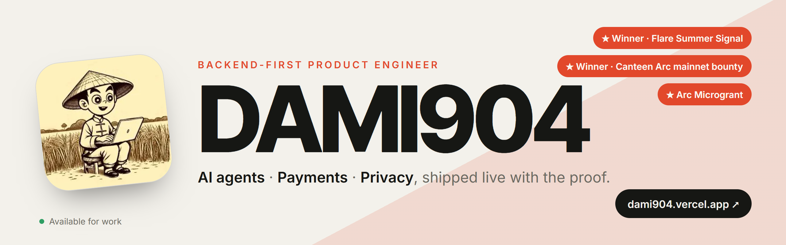
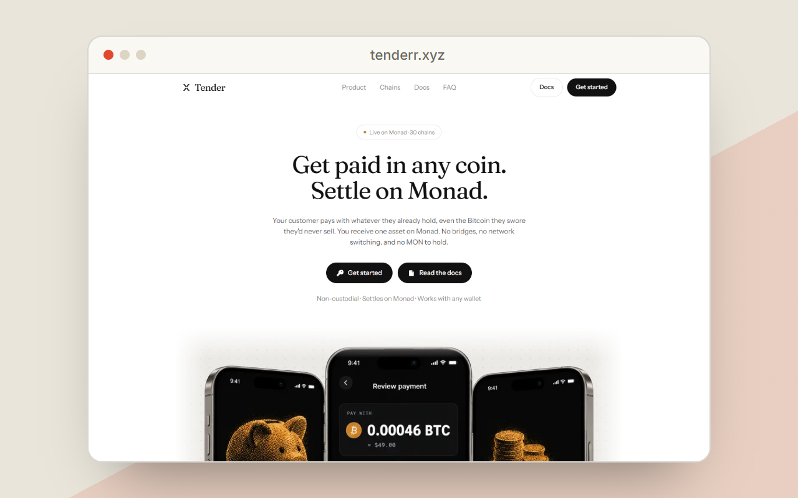
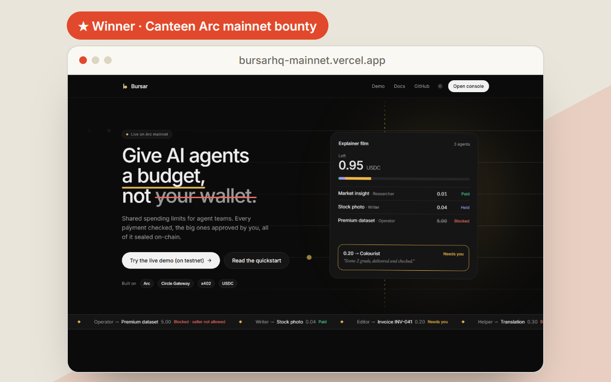
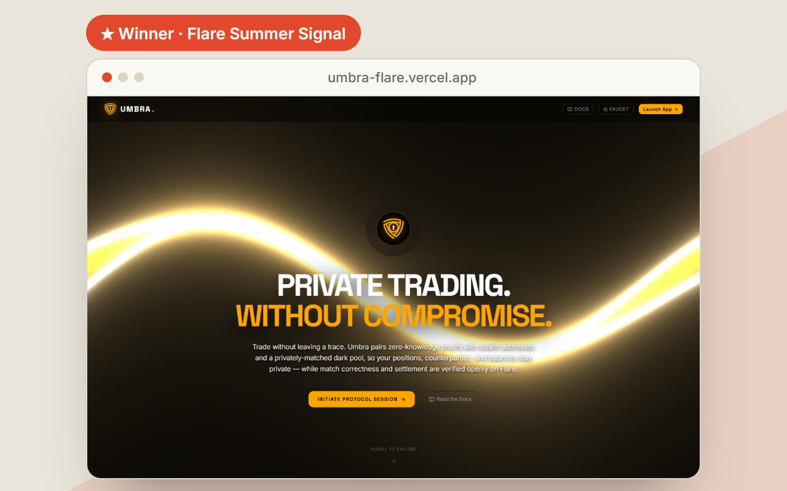
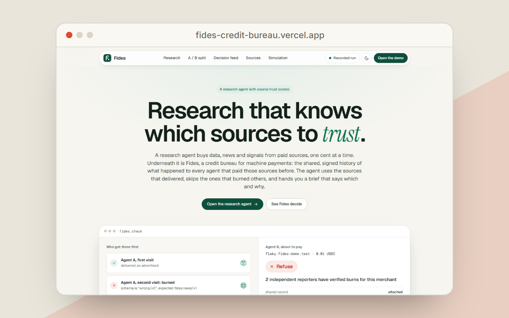
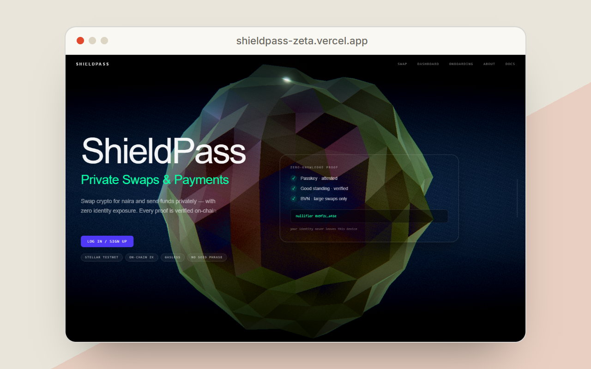
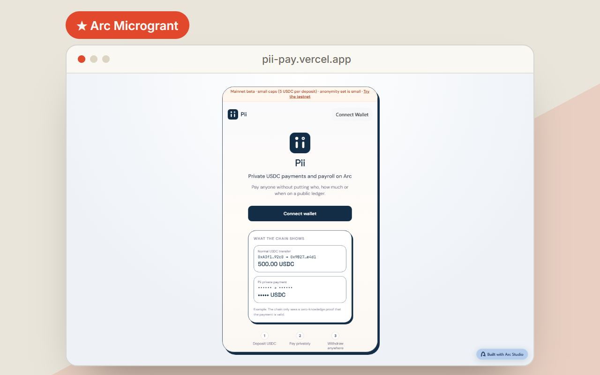

<a href="https://dami904.vercel.app">
  <picture>
    <source media="(prefers-color-scheme: dark)" srcset="assets/banner-dark.png" />
    
  </picture>
</a>

  <b>40+</b> products shipped &nbsp;·&nbsp; <b>12+</b> chains &nbsp;·&nbsp; <b>2,800+</b> tests across featured work &nbsp;·&nbsp; <b>3</b> awards &nbsp;·&nbsp; <b>7</b> merged PRs to KeeperHub

I build the backend of products where trust matters most (smart contracts, services, zero-knowledge circuits and payment integrations) and ship the whole product around it. Everything below is live, tested and documented, so a team can pick it up on day one.

## Featured work

<table>
<tr>
<td width="50%" valign="top">

### [Tender](https://github.com/Jhaycrypt001/Tender)
Crypto checkout for merchants. Customers pay with whatever they hold on **30 chains**; the merchant receives one asset on Monad.

Lead engineer · Monad · TypeScript, Next.js, NEAR Intents 
**[Live ↗](https://tenderr.xyz/)** · [Code](https://github.com/Jhaycrypt001/Tender)
</td>
<td width="50%" valign="top">

### [Bursar](https://github.com/Dami904/bursar)
Give AI agents a budget, not your wallet. Job-scoped spending limits, x402 nanopayments and an on-chain audit log.

🏆 Canteen Arc mainnet bounty winner · 355 tests · Arc 
**[Live ↗](https://bursarhq-mainnet.vercel.app/)** · [Code](https://github.com/Dami904/bursar)
</td>
</tr>
<tr>
<td width="50%" valign="top">

### [Umbra](https://github.com/davre001/UMBRA)
Private trading, verified in the open. A dark pool on Flare where zero-knowledge proofs verify every settlement.

🏆 Flare Summer Signal winner · lead engineer, team of 4 · Noir 
**[Live ↗](https://umbra-flare.vercel.app)** · [Code](https://github.com/davre001/UMBRA) · [Demo](https://youtu.be/vdFu4xjAEos)
</td>
<td width="50%" valign="top">

### [Fides](https://github.com/Dami904/Fides)
A credit bureau for machine payments. AI agents check a source's signed track record before they pay.

433 tests · mainnet package on Sui · Walrus Memory 
**[Live ↗](https://fides-credit-bureau.vercel.app)** · [Code](https://github.com/Dami904/Fides)
</td>
</tr>
<tr>
<td width="50%" valign="top">

### [ShieldPass](https://github.com/Xyrelix/ShieldPass)
Private swaps and payments on Stellar: crypto to naira straight to a bank account, with proofs verified on-chain.

Lead engineer, team of 4 · Soroban · Groth16 · Passkeys 
**[Live ↗](https://shieldpass-zeta.vercel.app)** · [Code](https://github.com/Xyrelix/ShieldPass)
</td>
<td width="50%" valign="top">

### [Pii](https://github.com/Dami904/pii)
Private USDC payments and payroll. A shielded pool where the chain only sees a valid proof.

🏆 Arc Microgrant · running on Arc mainnet with real USDC 
**[Live ↗](https://pii-pay.vercel.app)** · [Code](https://github.com/Dami904/pii) · [Demo](https://youtu.be/msSxzTkpYEI)
</td>
</tr>
</table>

<b>More projects</b>

 

- 🔐 **[Nema](https://github.com/Dami904/nema)**: private consensus prices for illiquid loans, computed inside an Intel TDX enclave. [Live](https://nema-near.vercel.app/)
- ⚖️ **[Kalyptra](https://github.com/Dami904/kalyptra)**: sealed-bid auctions for private company shares on Zcash, at one uniform clearing price. [Live](https://kalyptra.vercel.app)
- 🍇 **[Currant](https://github.com/Dami904/currant)**: keeps AI agents answering from the latest source, with a replayable receipt. [Live](https://currant-firewall.vercel.app)
- 🕯️ **[Somnix](https://github.com/davre001/Somnix)**: a one-tap prediction game on Somnia, built on DreamDEX Event Contracts. [Live](https://somnix-iota.vercel.app)
- 🧭 **[Steward](https://github.com/Dami904/steward)**: a policy engine for an RWA vault agent that earns higher limits from its on-chain record.
- 📈 **[Provenn](https://github.com/Dami904/Provenn)**: trading agents with verifiable track records on Solana.

All of it, with previews: **[dami904.vercel.app](https://dami904.vercel.app)**

## Open source

Contributor to **[KeeperHub](https://github.com/KeeperHub/keeperhub)**, a platform for automating on-chain workflows: **7 merged pull requests**, including Arc mainnet and testnet support with USDC, and nested loop handling in the workflow engine.

## Stack

<picture>
  <source media="(prefers-color-scheme: dark)" srcset="https://skillicons.dev/icons?i=ts%2Crust%2Csolidity%2Cpython%2Cnodejs%2Cnextjs%2Cpostgres&theme=dark" />
  
</picture>

Also: Move · Noir · Groth16 · Soroban · Foundry · x402 · Circle · NEAR Intents

---

  
  
  
  

